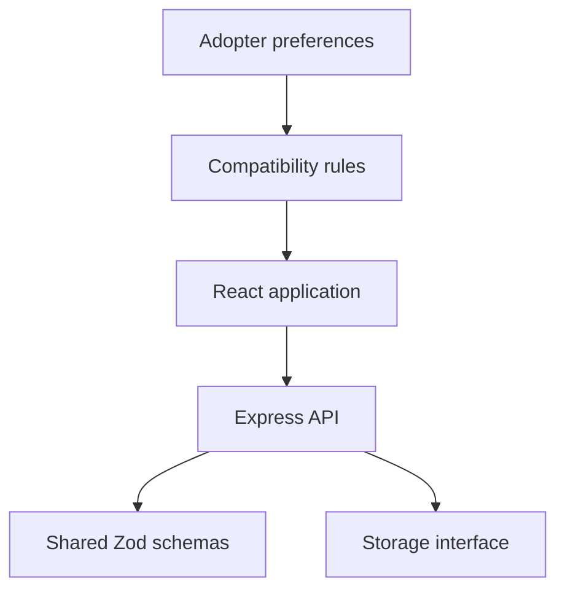

# PawMatch

### A full-stack dog-adoption discovery and matching application.

PawMatch brings dog profiles, adopter preferences, favorites, and shelter management into a React and TypeScript interface with an Express API.

## Project at a glance

| Layer | Implementation |
|---|---|
| Interface | React, TypeScript, Vite, Wouter |
| UI | Tailwind CSS, Radix UI, shadcn/ui |
| Data fetching | TanStack Query |
| Forms and validation | React Hook Form and Zod |
| API | Express with TypeScript |
| Data model | Shared schemas in `shared/schema.ts`; storage abstraction in `server/storage.ts` |
| Matching | Rule-based compatibility scoring using adopter and dog attributes |

## Workflows

- Browse dog profiles and filter available dogs.
- Complete an adopter-preference quiz and receive ranked recommendations.
- Save favorite dogs and inspect shelter information.
- Explore shelter-side listing management through the dashboard and API.

## Matching approach

The implemented recommendation path scores activity level, family and pet compatibility, preferred size, and age. A client-side scorer also considers yard access and time alone. The repository imports TensorFlow.js, but the current recommendation logic uses explicit rules rather than a trained model. Client and server scoring implementations should be consolidated before treating their scores as equivalent.

## Run locally

Use a supported Node.js installation and npm. The development scripts use POSIX environment-variable syntax; on Windows, use WSL or an equivalent shell.

```bash
git clone https://github.com/mahasmrtiadhuri/PawMatch.git
cd PawMatch
npm install
npm run dev
```

Open `http://localhost:5000`.

```bash
npm run check
npm run build
npm start
```

`check` runs the TypeScript compiler; `build` creates the client and server bundles. These are the repository's validation commands, not a claim that they were run in every environment.

## Architecture



## Repository guide

| Path | Responsibility |
|---|---|
| `client/src/pages/` | Application routes and screens |
| `client/src/components/` | Domain and UI components |
| `client/src/lib/recommendation.ts` | Client-side compatibility scoring |
| `server/routes.ts` | API routes, validation, and server recommendation path |
| `server/storage.ts` | Storage operations |
| `shared/schema.ts` | Shared domain types and schemas |
| `drizzle.config.ts` | Database tooling configuration |

## Scope

This is a demonstration application. The current API uses a `user-id` header for demo authentication and compares stored passwords directly. Replace that flow with password hashing and verified sessions before using real accounts or exposing a public deployment. Production database persistence and real-time synchronization should be verified independently rather than inferred from installed packages.

## Next engineering work

Consolidate recommendation scoring; add scoring and authorization tests; replace demo authentication; validate database-backed persistence; and add reproducible interface captures. These are planned improvements.
